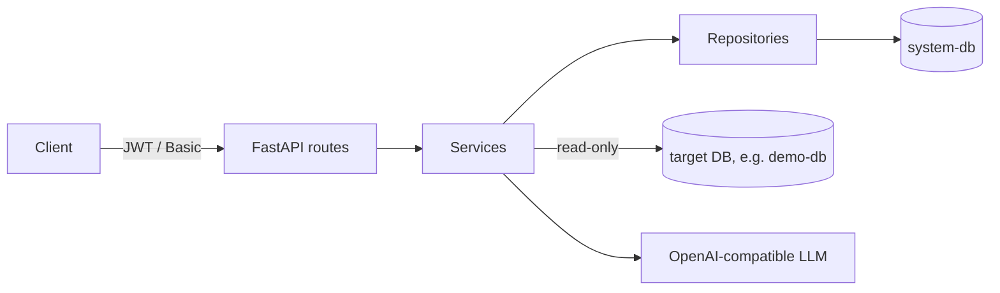

# LLM Data Discovery: Python implementation

A FastAPI service that connects to a PostgreSQL database, stores its schema metadata, and classifies columns into 12 PII categories with an OpenAI-compatible LLM.

> Task 1 of the case study. The Java port is in [../LLM_based_java](../LLM_based_java/). All commands below run from this folder (`cd LLM_based_python`).

**PII categories**: `email_address`, `phone_number`, `ssn`, `credit_card_number`, `national_id_number`, `full_name`, `first_name`, `last_name`, `tckn`, `home_address`, `date_of_birth`, `ip_address`.

## Architecture



- **System DB**: the service's own store (users, metadata snapshots, encrypted credentials, cached results).
- **Target DB**: the database being scanned, read-only. Compose ships one, `demo-db`, seeded with the case study script.

**Stack:** Python 3.12, FastAPI, Pydantic v2, SQLAlchemy 2 (async) + Alembic, asyncpg, httpx, Argon2id, JWT, AES-256-GCM, pytest, Docker Compose, PostgreSQL 16.

## Running the project

### Requirements

- Docker with Docker Compose v2
- An API key for an OpenAI-compatible LLM (or a local Ollama model, see below)

### 1. Configure

```bash
cp .env.example .env
```

Open `.env` and set `LLM_API_KEY`. The other values work as is for local development. Before any shared deployment, generate fresh secrets and change every `change-me-*` value:

```bash
openssl rand -hex 32      # JWT_SECRET_KEY
openssl rand -base64 32   # ENCRYPTION_KEY
```

### 2. Start

```bash
docker compose up --build -d
curl http://localhost:8000/health        # {"status":"ok"}
```

This starts three containers: `app` (port `8000`), `system-db`, and `demo-db` (host port `5433`). On every start:

- the app runs `alembic upgrade head` (migrations `0001`–`0004`) and creates the admin user from `AUTH_USERNAME` / `AUTH_PASSWORD`;
- `demo-db` runs the scripts in [db/demo/](db/demo/) only when its volume is empty (demo data plus the SELECT-only login `discovery_reader`).

| URL | What |
|---|---|
| http://localhost:8000/ | Web UI (sign in with `AUTH_USERNAME` / `AUTH_PASSWORD`) |
| http://localhost:8000/docs | Swagger UI (disabled when `APP_ENV=production`) |

### 3. Stop

```bash
docker compose down        # keep data
docker compose down -v     # also delete the databases (demo-db is re-seeded on next start)
```

### Optional: local LLM with Ollama

No data leaves the machine. Needs about 6 GB of memory for Docker.

```bash
docker compose --profile local-llm up -d
docker compose exec ollama ollama pull llama3.1
# in .env: LLM_BASE_URL=http://ollama:11434/v1  LLM_API_KEY=  LLM_MODEL=llama3.1  LLM_TIMEOUT=300
docker compose up -d app
```

### Running tests

```bash
# Unit + integration + e2e (LLM mocked, throwaway databases)
docker compose --profile test run --build --rm tests
docker compose rm -sf test-system-db test-target-db

# Unit tests only, without Docker
python -m venv .venv && source .venv/bin/activate
pip install -r requirements-dev.txt
pytest tests/unit

# Black-box contract tests against the running service (real LLM)
docker compose --profile contract run --build --rm contract-tests
```

## API

Base URL: `http://localhost:8000/api/v1`. The examples use the default credentials from `.env.example`; replace them if you changed `.env`. `jq` is optional and only used to pretty-print and extract values.

| Method | Path | Description |
|---|---|---|
| `GET` | `/health` | Liveness check (no auth) |
| `GET` | `/health/ready` | Readiness: `200` when the system DB answers, `503` otherwise (no auth) |
| `POST` | `/api/v1/auth` | Get a JWT |
| `POST` | `/api/v1/auth/logout` | Revoke the Bearer token sent with the request |
| `POST` | `/api/v1/db/metadata` | Connect to a database and store its metadata |
| `GET` | `/api/v1/metadata` | List metadata snapshots |
| `GET` | `/api/v1/metadata/{metadata_id}` | Tables and columns of a snapshot |
| `DELETE` | `/api/v1/metadata/{metadata_id}` | Delete a snapshot |
| `POST` | `/api/v1/classify` | Classify a column into the 12 PII categories |

The same endpoints are also served without the `/api/v1` prefix (`/auth`, `/db/metadata`, ...), as listed in the case study. A ready-made walkthrough for VS Code / JetBrains is in [requests.http](requests.http).

Set these once in your shell; the examples below reuse them:

```bash
API=http://localhost:8000/api/v1
```

### `POST /auth`

Returns a JWT. Credentials can be sent as a JSON body or with HTTP Basic.

**JSON body**

```bash
curl -s -X POST $API/auth \
  -H "Content-Type: application/json" \
  -d '{"username":"admin","password":"change-me-admin"}'
```

```json
{"access_token":"eyJhbGciOi...","token_type":"bearer","expires_in":3600}
```

**HTTP Basic**

```bash
curl -s -X POST $API/auth -u admin:change-me-admin
```

**Save the token for the next requests**

```bash
TOKEN=$(curl -s -X POST $API/auth -u admin:change-me-admin | jq -r .access_token)
```

**Wrong password → `401`**

```bash
curl -s -X POST $API/auth -u admin:wrong-password
# {"detail":"Invalid credentials"}
```

**No credentials → `401`**

```bash
curl -s -X POST $API/auth
# {"detail":"Provide credentials as a JSON body or with HTTP Basic authentication"}
```

**Too many wrong passwords → `429`**: after 5 wrong passwords for one user (or 20 in total) from one address within 5 minutes, `/auth` and Basic credentials answer `429` with a `Retry-After` header until the window passes.

Every other `/api/v1` endpoint needs `Authorization: Bearer $TOKEN`. HTTP Basic (`-u admin:change-me-admin`) is accepted there as well.

### `POST /auth/logout`

Revokes the Bearer token sent with the request (stored by its `jti` until it would expire). Other tokens stay valid. The web UI calls it on "Sign out".

```bash
curl -s -o /dev/null -w "%{http_code}\n" -X POST $API/auth/logout -H "Authorization: Bearer $TOKEN"
# 204
curl -s $API/metadata -H "Authorization: Bearer $TOKEN"
# {"detail":"Invalid or expired token"}
```

Basic credentials have nothing to revoke → `400`; no or invalid token → `401`.

### `GET /health/ready`

For orchestrators (Kubernetes readiness probe, load balancers). `/health` only says the process runs; this one runs `SELECT 1` on the system DB with a 3 s limit. The LLM is not called.

```bash
curl -s http://localhost:8000/health/ready
# {"status":"ok","checks":{"system_db":"ok"}}
# system DB down → 503 {"status":"unavailable","checks":{"system_db":"unavailable"}}
```

### `POST /db/metadata`

Connects to a PostgreSQL database, extracts its tables, views and columns, and stores them as a new snapshot. Returns `201` with the snapshot. Each call creates a new snapshot with new column IDs.

The app runs inside Docker Compose, so the demo database host is `demo-db` (port `5432`), not `localhost`.

**All schemas of the demo database**

```bash
curl -s -X POST $API/db/metadata \
  -H "Authorization: Bearer $TOKEN" \
  -H "Content-Type: application/json" \
  -d '{
    "host": "demo-db",
    "port": 5432,
    "database": "llm_discovery_demo",
    "username": "discovery_reader",
    "password": "change-me-demo-reader"
  }' | jq
```

```json
{
  "metadata_id": "1a2b...",
  "connection_id": "9c8d...",
  "database_name": "llm_discovery_demo",
  "schema_name": null,
  "host": "demo-db",
  "port": 5432,
  "created_at": "2026-11-07T10:00:00Z",
  "table_count": 9,
  "tables": [
    {
      "table_id": "...",
      "schema_name": "public",
      "table_name": "customers",
      "table_type": "TABLE",
      "columns": [
        {"column_id": "8f0c...", "column_name": "email", "data_type": "character varying(100)", "is_nullable": false, "ordinal_position": 5}
      ]
    }
  ]
}
```

**Save the snapshot ID**

```bash
METADATA_ID=$(curl -s -X POST $API/db/metadata \
  -H "Authorization: Bearer $TOKEN" \
  -H "Content-Type: application/json" \
  -d '{"host":"demo-db","port":5432,"database":"llm_discovery_demo","username":"discovery_reader","password":"change-me-demo-reader"}' \
  | jq -r .metadata_id)
```

**Only one schema** (`schema_name`)

```bash
curl -s -X POST $API/db/metadata \
  -H "Authorization: Bearer $TOKEN" \
  -H "Content-Type: application/json" \
  -d '{"host":"demo-db","port":5432,"database":"llm_discovery_demo","username":"discovery_reader","password":"change-me-demo-reader","schema_name":"public"}' \
  | jq '{metadata_id, schema_name, table_count}'
```

**Unknown schema → `422`**

```bash
curl -s -X POST $API/db/metadata \
  -H "Authorization: Bearer $TOKEN" \
  -H "Content-Type: application/json" \
  -d '{"host":"demo-db","port":5432,"database":"llm_discovery_demo","username":"discovery_reader","password":"change-me-demo-reader","schema_name":"no_such_schema"}'
# {"detail":"Schema 'no_such_schema' does not exist or has no tables"}
```

**Wrong password or unreachable host → `400`**

```bash
curl -s -X POST $API/db/metadata \
  -H "Authorization: Bearer $TOKEN" \
  -H "Content-Type: application/json" \
  -d '{"host":"demo-db","port":5432,"database":"llm_discovery_demo","username":"discovery_reader","password":"wrong"}'
# {"detail":"Could not connect to the target database. Check the connection details and that the database is reachable."}
```

**Missing field → `422`**

```bash
curl -s -X POST $API/db/metadata \
  -H "Authorization: Bearer $TOKEN" \
  -H "Content-Type: application/json" \
  -d '{"host":"demo-db","database":"llm_discovery_demo"}'
```

**No token → `401`**

```bash
curl -s -X POST $API/db/metadata \
  -H "Content-Type: application/json" \
  -d '{"host":"demo-db","port":5432,"database":"llm_discovery_demo","username":"discovery_reader","password":"change-me-demo-reader"}'
# {"detail":"Not authenticated"}
```

### `GET /metadata`

Lists snapshots, newest first. Query parameters: `limit` (1–500, default 50) and `offset` (default 0).

**Default page**

```bash
curl -s $API/metadata -H "Authorization: Bearer $TOKEN" | jq
```

```json
{
  "total": 2,
  "items": [
    {"metadata_id": "1a2b...", "connection_id": "9c8d...", "database_name": "llm_discovery_demo", "schema_name": null, "host": "demo-db", "port": 5432, "created_at": "2026-11-07T10:00:00Z", "table_count": 9}
  ]
}
```

**Pagination**

```bash
curl -s "$API/metadata?limit=5&offset=5" -H "Authorization: Bearer $TOKEN" | jq
```

**With HTTP Basic instead of a token**

```bash
curl -s $API/metadata -u admin:change-me-admin | jq '.total'
```

**Invalid `limit` → `422`**

```bash
curl -s "$API/metadata?limit=0" -H "Authorization: Bearer $TOKEN"
```

### `GET /metadata/{metadata_id}`

Returns a snapshot with all tables and columns, including the `column_id` needed for classification.

**Full detail**

```bash
curl -s $API/metadata/$METADATA_ID -H "Authorization: Bearer $TOKEN" | jq
```

**Table names only**

```bash
curl -s $API/metadata/$METADATA_ID -H "Authorization: Bearer $TOKEN" \
  | jq -r '.tables[] | "\(.schema_name).\(.table_name) (\(.table_type))"'
```

**Find a column ID (`customers.email`)**

```bash
COLUMN_ID=$(curl -s $API/metadata/$METADATA_ID -H "Authorization: Bearer $TOKEN" \
  | jq -r '.tables[] | select(.table_name=="customers") | .columns[] | select(.column_name=="email") | .column_id')
echo $COLUMN_ID
```

**Unknown ID → `404`**

```bash
curl -s $API/metadata/00000000-0000-0000-0000-000000000000 -H "Authorization: Bearer $TOKEN"
```

**Not a UUID → `422`**

```bash
curl -s $API/metadata/abc -H "Authorization: Bearer $TOKEN"
```

### `POST /classify`

Samples up to `sample_count` distinct values of a column, masks them, and asks the LLM for a probability distribution over the 12 categories. Deterministic checks (TCKN checksum, Luhn, email and IP format) on the raw samples are fused into the result.

| Field | Required | Default | Notes |
|---|---|---|---|
| `column_id` | yes | | From `GET /metadata/{id}` |
| `sample_count` | no | `10` | `1` to `MAX_SAMPLE_COUNT` (default 100) |
| `force_refresh` | no | `false` | Skip the cache and call the LLM again |

**Classify a column**

```bash
curl -s -X POST $API/classify \
  -H "Authorization: Bearer $TOKEN" \
  -H "Content-Type: application/json" \
  -d "{\"column_id\":\"$COLUMN_ID\",\"sample_count\":10}" | jq
```

```json
{
  "column_id": "8f0c...",
  "metadata_id": "1a2b...",
  "schema_name": "public",
  "table_name": "customers",
  "column_name": "email",
  "data_type": "character varying(100)",
  "sample_count_requested": 10,
  "sample_count_used": 5,
  "masking_mode": "partial",
  "classification": {
    "email_address": 0.98, "phone_number": 0.0, "ssn": 0.0, "credit_card_number": 0.0,
    "national_id_number": 0.0, "full_name": 0.02, "first_name": 0.0, "last_name": 0.0,
    "tckn": 0.0, "home_address": 0.0, "date_of_birth": 0.0, "ip_address": 0.0
  },
  "predicted_category": "email_address",
  "pii_likelihood": 0.99,
  "llm_classification": {"email_address": 0.95, "full_name": 0.05, "...": 0.0},
  "llm_pii_likelihood": 0.97,
  "checksum_evidence": [
    {"category": "email_address", "check": "email_format", "matched": 5, "checked": 5, "weight": 0.6}
  ],
  "reasoning": "All samples are email addresses.",
  "model": "gpt-4o-mini",
  "classified_at": "2026-11-07T10:01:00Z",
  "cached": false
}
```

- `classification` always has all 12 categories and sums to 1. `predicted_category` is the highest one, or `null` when nothing fits.
- `pii_likelihood` says whether the column is PII at all (e.g. `products.unit_price` scores near 0).
- `llm_*` fields are the LLM answer before the deterministic checks were applied.
- Scores are model confidence, not calibrated probabilities. Sample values are never returned.

**Short summary only**

```bash
curl -s -X POST $API/classify \
  -H "Authorization: Bearer $TOKEN" \
  -H "Content-Type: application/json" \
  -d "{\"column_id\":\"$COLUMN_ID\"}" \
  | jq '{column_name, predicted_category, pii_likelihood, cached}'
```

**Same request again → served from cache** (`"cached": true`, ~30 ms instead of ~3 s)

```bash
curl -s -X POST $API/classify \
  -H "Authorization: Bearer $TOKEN" \
  -H "Content-Type: application/json" \
  -d "{\"column_id\":\"$COLUMN_ID\",\"sample_count\":10}" | jq '.cached'
```

**Force a fresh LLM call**

```bash
curl -s -X POST $API/classify \
  -H "Authorization: Bearer $TOKEN" \
  -H "Content-Type: application/json" \
  -d "{\"column_id\":\"$COLUMN_ID\",\"sample_count\":10,\"force_refresh\":true}" | jq '{cached, classified_at}'
```

**TCKN column (checksum evidence)**: `customers.national_id`

```bash
COL=$(curl -s $API/metadata/$METADATA_ID -H "Authorization: Bearer $TOKEN" \
  | jq -r '.tables[] | select(.table_name=="customers") | .columns[] | select(.column_name=="national_id") | .column_id')
curl -s -X POST $API/classify \
  -H "Authorization: Bearer $TOKEN" \
  -H "Content-Type: application/json" \
  -d "{\"column_id\":\"$COL\",\"sample_count\":20}" \
  | jq '{predicted_category, pii_likelihood, checksum_evidence}'
```

**Non-PII column**: `products.unit_price`

```bash
COL=$(curl -s $API/metadata/$METADATA_ID -H "Authorization: Bearer $TOKEN" \
  | jq -r '.tables[] | select(.table_name=="products") | .columns[] | select(.column_name=="unit_price") | .column_id')
curl -s -X POST $API/classify \
  -H "Authorization: Bearer $TOKEN" \
  -H "Content-Type: application/json" \
  -d "{\"column_id\":\"$COL\"}" \
  | jq '{predicted_category, pii_likelihood, reasoning}'
```

**Every column of a table** (`customers`)

```bash
for COL in $(curl -s $API/metadata/$METADATA_ID -H "Authorization: Bearer $TOKEN" \
    | jq -r '.tables[] | select(.table_name=="customers") | .columns[].column_id'); do
  curl -s -X POST $API/classify \
    -H "Authorization: Bearer $TOKEN" \
    -H "Content-Type: application/json" \
    -d "{\"column_id\":\"$COL\"}" \
    | jq -c '{column_name, predicted_category, pii_likelihood}'
done
```

**`sample_count` too large → `422`**

```bash
curl -s -X POST $API/classify \
  -H "Authorization: Bearer $TOKEN" \
  -H "Content-Type: application/json" \
  -d "{\"column_id\":\"$COLUMN_ID\",\"sample_count\":1000}"
# {"detail":"sample_count must be at most 100"}
```

**`sample_count` below 1 → `422`**

```bash
curl -s -X POST $API/classify \
  -H "Authorization: Bearer $TOKEN" \
  -H "Content-Type: application/json" \
  -d "{\"column_id\":\"$COLUMN_ID\",\"sample_count\":0}"
```

**Unknown column → `404`**

```bash
curl -s -X POST $API/classify \
  -H "Authorization: Bearer $TOKEN" \
  -H "Content-Type: application/json" \
  -d '{"column_id":"00000000-0000-0000-0000-000000000000"}'
```

### `DELETE /metadata/{metadata_id}`

Deletes a snapshot with its tables, columns and cached classification results. The stored connection is deleted together with its last snapshot.

**Delete a snapshot**

```bash
curl -s -X DELETE $API/metadata/$METADATA_ID -H "Authorization: Bearer $TOKEN"
# {"metadata_id":"1a2b...","deleted":true}
```

**Check it is gone → `404`**

```bash
curl -s -o /dev/null -w "%{http_code}\n" $API/metadata/$METADATA_ID -H "Authorization: Bearer $TOKEN"
# 404
```

**Delete again → `404`**

```bash
curl -s -X DELETE $API/metadata/$METADATA_ID -H "Authorization: Bearer $TOKEN"
```

**Delete every snapshot**

```bash
for ID in $(curl -s "$API/metadata?limit=500" -H "Authorization: Bearer $TOKEN" | jq -r '.items[].metadata_id'); do
  curl -s -X DELETE $API/metadata/$ID -H "Authorization: Bearer $TOKEN"; echo
done
```

### Error responses

All errors return `{"detail": ...}`.

| Status | When |
|---|---|
| `400` | `POST /db/metadata` cannot connect with the given details, or the target host is not allowed (see `TARGET_DB_ALLOWED_HOSTS`) |
| `401` | Missing or invalid credentials / token |
| `404` | Unknown metadata or column ID |
| `409` | The column or table no longer exists in the target DB (snapshot is stale) |
| `413` | Request body larger than `MAX_REQUEST_BODY_BYTES` |
| `429` | Too many failed logins from this client (`POST /auth` or Basic credentials); wait for `Retry-After` seconds |
| `422` | Validation error (missing field, bad UUID, `sample_count` out of range, unknown `schema_name`) |
| `502` | Target DB unreachable, or the LLM failed / returned unusable output |

## Configuration

All settings come from `.env`; [.env.example](.env.example) lists and explains every variable. The most useful ones:

| Variable | Default | Purpose |
|---|---|---|
| `LLM_BASE_URL`, `LLM_API_KEY`, `LLM_MODEL` | OpenAI, empty, `gpt-4o-mini` | Any OpenAI-compatible `/chat/completions` API |
| `AUTH_USERNAME`, `AUTH_PASSWORD` | `admin`, `change-me-admin` | Login for the API and UI |
| `SAMPLE_MASKING_MODE` | `partial` | `none`, `partial` (mask email local part and middle digits) or `strict` (shape only) |
| `MAX_SAMPLE_COUNT` | `100` | Upper limit for `sample_count` |
| `CHECKSUM_VALIDATION_ENABLED` | `true` | Fuse TCKN / Luhn / email / IP checks into the result |
| `CLASSIFICATION_CACHE_TTL_SECONDS` | `86400` | Cache lifetime; `0` disables the cache |
| `TARGET_DB_SSL_MODE`, `TARGET_DB_SSL_ROOT_CERT` | `prefer`, empty | TLS to target DBs: `disable`, `prefer`, `require`, `verify-ca`, `verify-full`; CA bundle for the `verify-*` modes (system trust store when empty) |
| `TARGET_DB_ALLOWED_HOSTS` | empty | Hostnames, IPs or CIDRs targets may use; empty = any host except the denied ones (see Security) |
| `AUTH_MAX_FAILED_ATTEMPTS`, `AUTH_MAX_FAILED_ATTEMPTS_PER_IP`, `AUTH_FAILURE_WINDOW_SECONDS` | `5`, `20`, `300` | Failed logins allowed per client IP + username and per client IP within the window; `0` disables a limit |

**LLM providers:** any OpenAI-compatible API works: OpenAI (`https://api.openai.com/v1`), Ollama (`http://ollama:11434/v1`, or `http://host.docker.internal:11434/v1` when installed on the host), vLLM, LM Studio, Azure OpenAI. Leave `LLM_API_KEY` empty if the provider needs no key; set `LLM_JSON_MODE=false` if it rejects `response_format`.

## Project layout

```
app/
  api/routes/          HTTP endpoints only
  services/            business logic (metadata, classification, masking, checksums, cache)
  repositories/        system DB queries
  infrastructure/      target DB access, LLM client and prompts
  core/                config, security (JWT, Argon2, AES-GCM), login throttling
  domain/              ORM models and request/response schemas
alembic/               system DB migrations
db/demo/               demo database init scripts
tests/                 unit, integration, e2e, contract
```

## How Classification Works

1. Look up the column and its stored connection; open a read-only session with a statement timeout.
2. Fetch up to `sample_count` distinct non-null values (deterministic order, truncated to 200 characters).
3. If the samples, model, prompt and settings are unchanged, return the cached result (`cached: true`).
4. Mask the samples (`SAMPLE_MASKING_MODE`) and send them to the LLM with the category definitions; the reply must be JSON.
5. Validate the reply (12 categories, values in `[0, 1]`, normalized to sum 1); retry invalid replies, timeouts, 429 and 5xx.
6. Run deterministic checks on the raw samples and fuse them in when at least 80% match: `tckn_checksum` (weight 0.6), `tckn_format` (0.3), `luhn`, `email_format`, `ip_address` (0.6 each). Store the result in the cache.

## Security Considerations

- All `/api/v1` endpoints except `/auth` need a JWT or Basic credentials. Passwords are hashed with Argon2id.
- Failed logins (`/auth` and Basic credentials alike) are throttled per client IP + username and per client IP; over the limit the API answers `429` with `Retry-After`, before checking the password. Keying on the IP means a stranger cannot lock the admin out. The counts are kept in memory, per process: with several workers or replicas, add a limit at the reverse proxy or a shared store.
- Target DB passwords are encrypted with AES-256-GCM and never returned. Changing `ENCRYPTION_KEY` makes stored connections unreadable.
- Target access has two layers: read-only sessions with a statement timeout, and a SELECT-only login (`discovery_reader` in the demo).
- Identifiers are validated and quoted; the only SQL value (sample limit) is bound. LLM output is validated, never executed.
- No credentials or sample values are logged; API errors are generic. CORS is off unless `CORS_ALLOWED_ORIGINS` is set.
- The app refuses to start with weak secrets, or with `.env.example` values when `APP_ENV=production`.
- Masked samples still leave the system. For real personal data use a self-hosted model (Ollama profile) or a provider with suitable KVKK/GDPR terms.
- `POST /db/metadata` connects to caller-supplied hosts, so every target host is checked first ([host_policy.py](app/infrastructure/database/host_policy.py)): the system database is never allowed; link-local (cloud metadata `169.254.169.254`), multicast, unspecified and reserved addresses are always denied; loopback only when listed in `TARGET_DB_ALLOWED_HOSTS`. All resolved addresses must pass, and the connection uses those addresses (no second DNS lookup, so DNS rebinding cannot bypass the check). Private ranges stay allowed so internal databases work; in production set `TARGET_DB_ALLOWED_HOSTS` and restrict egress as well.
- Target DB connections use TLS when the server offers it (`TARGET_DB_SSL_MODE=prefer`, unverified, like libpq). Use `verify-full` with `TARGET_DB_SSL_ROOT_CERT` in production so credentials and samples cannot be read or the server impersonated. In `verify-full` the driver connects to the host name (the certificate is checked against it), so DNS is resolved a second time; a changed answer then also needs a valid certificate. Compose runs `demo-db` with TLS and a development certificate ([db/certs](db/certs/README.md), never for real use).
- Tokens carry a `jti`; `POST /auth/logout` stores it in `revoked_tokens` until the token's expiry, and every Bearer request checks that table. Tokens issued before this existed have no `jti`: valid until they expire, not revocable.
- Run behind TLS in production.

## Design Decisions

- **Re-extraction** creates a new snapshot with new column IDs; the connection row is reused. Snapshots are immutable history.
- **Non-PII columns**: `classification` always sums to 1, so a separate `pii_likelihood` says whether the column is PII at all. When nothing fits: `predicted_category: null`, `pii_likelihood: 0`.
- **Mixed columns** spread probability across categories; deterministic checks only fire when ≥ 80% of samples match.
- **Scores** are model confidence, not calibrated probabilities, stabilized by deterministic checks and the cache.
- **Deleting a snapshot** removes its tables, columns and cached results; the connection goes with its last snapshot.
- **Views** are included (`table_type: VIEW`), so the demo DB has 9 relations (8 tables + 1 view).
- **Auth** accepts both a JSON body and HTTP Basic; the JWT avoids repeated Argon2 checks.

The full decision log and evaluation results are in [../TASK.md](../TASK.md).

## Known Limitations

- Sampling scans the whole column (`DISTINCT … ORDER BY md5(value)`); large tables would benefit from `TABLESAMPLE`.
- One column per request; there is no batch or whole-table classification endpoint.
- **Mixed-content columns** (e.g. JSON logs) get a single distribution, so the percentages show how the content is split, not the chance that the column is one type. `audit_logs.new_values` scores email 40% and first/last/full name 20% each: only 1 of its 5 values holds PII, and the names together outweigh the email even though `predicted_category` is `email_address`. The UI labels such results "Mixed content"; a per-category presence score (multi-label) would describe them better.
- **Sensitive data outside the 12 categories** (salary, IBAN, tax number) is not flagged; it would need an extra "other sensitive" signal.
- `tckn_format` also matches other 11-digit IDs; masked card numbers cannot be Luhn-checked; fusion weights are hand-set.
- A cache hit still queries the target DB (to fingerprint the samples).
- One bootstrap admin user, no user management endpoints.
- The body size limit relies on `Content-Length`; a reverse proxy should enforce a hard limit.
- Login throttling is in memory and per process (reset on restart, not shared between replicas).
- Migration `0002` is irreversible.
