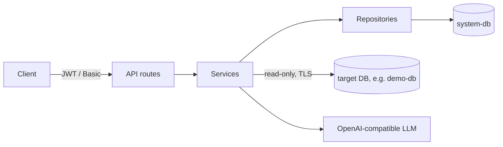

# LLM-Based Database Data Discovery System

Connects to a PostgreSQL database, stores its schema (tables, views, columns), and classifies columns into 12 PII categories with an OpenAI-compatible LLM. The case study asks for the system twice:

| Folder | Task | Stack | Port |
|---|---|---|---|
| [LLM_based_python/](LLM_based_python/) | Task 1: reference implementation | Python 3.12, FastAPI, Pydantic v2, SQLAlchemy 2 (async) + Alembic, asyncpg, httpx | 8000 |
| [LLM_based_java/](LLM_based_java/) | Task 2: AI-assisted port ([migration report](LLM_based_java/docs/MIGRATION_REPORT.md)) | Java 21, Spring Boot 3.5, JPA + Flyway, JDBC, Micrometer | 8080 |

Both serve the same HTTP API and JSON contract and use PostgreSQL 16, Argon2id, JWT, AES-256-GCM and Docker Compose. Each folder is self-contained (own `docker-compose.yml`, `.env.example`, demo database). Progress, decisions and test cases are in [TASK.md](TASK.md).

**PII categories:** `email_address`, `phone_number`, `ssn`, `credit_card_number`, `national_id_number`, `full_name`, `first_name`, `last_name`, `tckn`, `home_address`, `date_of_birth`, `ip_address`.

## Architecture



- **System DB:** the service's own store: users, metadata snapshots, encrypted target credentials, cached results, revoked tokens.
- **Target DB:** the database being scanned, read-only. Compose ships one, `demo-db`, seeded with the case study script plus a SELECT-only login `discovery_reader`.
- Layers: routes (HTTP only) → services (business logic) → repositories (system DB) and infrastructure (target DB, LLM client, prompts). Python: `app/{api,services,repositories,infrastructure,core,domain}`; Java: `com.llmdiscovery.{auth,discovery,classification,common}`.

## Quick start

Requirements: Docker with Compose v2, and an API key for an OpenAI-compatible LLM (or a local Ollama model, below).

```bash
cd LLM_based_python          # or LLM_based_java
cp .env.example .env         # set LLM_API_KEY; the rest works for local development
docker compose up --build -d
curl http://localhost:8000/health    # Java: 8080 → {"status":"ok"}
```

Before any shared deployment, replace every `change-me-*` value and the development keys (`openssl rand -hex 32` for `JWT_SECRET_KEY`, `openssl rand -base64 32` for `ENCRYPTION_KEY`); with `APP_ENV=production` the app refuses to start on the example values.

Compose starts `system-db`, `demo-db` (host port 5433 Python / 5434 Java), a one-off `migrate` container and then `app`:

- `migrate` brings the system DB schema up to date and exits (Python: Alembic `0001`–`0005`; Java: Flyway `V1`–`V3`). `app` starts only after it succeeded, refuses to start if the schema is behind (the log names the command to run) and creates the admin user from `AUTH_USERNAME` / `AUTH_PASSWORD`. After an upgrade without restarting everything: `docker compose run --rm migrate`. `MIGRATE_ON_START=true` migrates inside the app instead (single instance without compose).
- `demo-db` runs [db/demo/](LLM_based_python/db/demo/) only when its volume is empty.

| URL | What |
|---|---|
| `http://localhost:8000/` | Web UI (sign in with `AUTH_USERNAME` / `AUTH_PASSWORD`) |
| `http://localhost:8000/docs` | Swagger UI (off when `APP_ENV=production`). Log in with `POST /api/v1/auth`, click **Authorize**, paste the token without `Bearer` |

Stop with `docker compose down` (`-v` also deletes the databases; `demo-db` is re-seeded next time).

**Local LLM (no data leaves the machine, ~6 GB memory):**

```bash
docker compose --profile local-llm up -d
docker compose exec ollama ollama pull llama3.1
# in .env: LLM_BASE_URL=http://ollama:11434/v1  LLM_API_KEY=  LLM_MODEL=llama3.1  LLM_TIMEOUT=300
docker compose up -d app
```

## Documentation

- [docs/GUIDE.md](docs/GUIDE.md): [API and examples](docs/GUIDE.md#api), [configuration](docs/GUIDE.md#configuration), [security](docs/GUIDE.md#security), [observability](docs/GUIDE.md#observability), [running tests](docs/GUIDE.md#running-tests), [troubleshooting](docs/GUIDE.md#troubleshooting), [known limitations](docs/GUIDE.md#known-limitations).
- [TASK.md](TASK.md): status, decisions, test totals, change log and evaluation results.
- [Migration report](LLM_based_java/docs/MIGRATION_REPORT.md): how the Java port was made and verified.
- [docs/SPECIFICATION.md](docs/SPECIFICATION.md): the specification as received.
