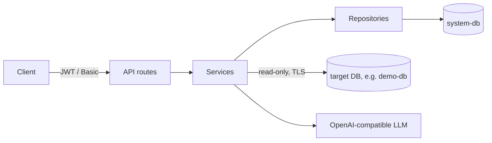

# LLM-Based Database Data Discovery System

Connects to a PostgreSQL database, stores its schema (tables, views, columns), and classifies columns into 12 PII categories with an OpenAI-compatible LLM. The case study asks for the system twice:

| Folder | Task | Stack | Port |
|---|---|---|---|
| [LLM_based_python/](LLM_based_python/) | Task 1: reference implementation | Python 3.12, FastAPI, Pydantic v2, SQLAlchemy 2 (async) + Alembic, asyncpg, httpx | 8000 |
| [LLM_based_java/](LLM_based_java/) | Task 2: AI-assisted port ([migration report](LLM_based_java/docs/MIGRATION_REPORT.md)) | Java 21, Spring Boot 3.5, JPA + Flyway, JDBC, Micrometer | 8080 |

Both serve the same HTTP API and JSON contract and use PostgreSQL 16, Argon2id, JWT, AES-256-GCM and Docker Compose. Each folder is self-contained (own `docker-compose.yml`, `.env.example`, demo database). Progress, decisions and test cases are in [TASK.md](TASK.md).

**PII categories:** `email_address`, `phone_number`, `ssn`, `credit_card_number`, `national_id_number`, `full_name`, `first_name`, `last_name`, `tckn`, `home_address`, `date_of_birth`, `ip_address`.

## Architecture



- **System DB:** the service's own store: users, metadata snapshots, encrypted target credentials, cached results, revoked tokens.
- **Target DB:** the database being scanned, read-only. Compose ships one, `demo-db`, seeded with the case study script plus a SELECT-only login `discovery_reader`.
- Layers: routes (HTTP only) → services (business logic) → repositories (system DB) and infrastructure (target DB, LLM client, prompts). Python: `app/{api,services,repositories,infrastructure,core,domain}`; Java: `com.llmdiscovery.{auth,discovery,classification,common}`.

## Quick start

Requirements: Docker with Compose v2, and an API key for an OpenAI-compatible LLM (or a local Ollama model, below).

```bash
cd LLM_based_python          # or LLM_based_java
cp .env.example .env         # set LLM_API_KEY; the rest works for local development
docker compose up --build -d
curl http://localhost:8000/health    # Java: 8080 → {"status":"ok"}
```

Before any shared deployment, replace every `change-me-*` value and the development keys (`openssl rand -hex 32` for `JWT_SECRET_KEY`, `openssl rand -base64 32` for `ENCRYPTION_KEY`); with `APP_ENV=production` the app refuses to start on the example values.

Compose starts `system-db`, `demo-db` (host port 5433 Python / 5434 Java), a one-off `migrate` container and then `app`:

- `migrate` brings the system DB schema up to date and exits (Python: Alembic `0001`–`0005`; Java: Flyway `V1`–`V3`). `app` starts only after it succeeded, refuses to start if the schema is behind (the log names the command to run) and creates the admin user from `AUTH_USERNAME` / `AUTH_PASSWORD`. After an upgrade without restarting everything: `docker compose run --rm migrate`. `MIGRATE_ON_START=true` migrates inside the app instead (single instance without compose).
- `demo-db` runs [db/demo/](LLM_based_python/db/demo/) only when its volume is empty.

| URL | What |
|---|---|
| `http://localhost:8000/` | Web UI (sign in with `AUTH_USERNAME` / `AUTH_PASSWORD`) |
| `http://localhost:8000/docs` | Swagger UI (off when `APP_ENV=production`). Log in with `POST /api/v1/auth`, click **Authorize**, paste the token without `Bearer` |

Stop with `docker compose down` (`-v` also deletes the databases; `demo-db` is re-seeded next time).

**Local LLM (no data leaves the machine, ~6 GB memory):**

```bash
docker compose --profile local-llm up -d
docker compose exec ollama ollama pull llama3.1
# in .env: LLM_BASE_URL=http://ollama:11434/v1  LLM_API_KEY=  LLM_MODEL=llama3.1  LLM_TIMEOUT=300
docker compose up -d app
```

Any OpenAI-compatible `/chat/completions` API works (OpenAI, Ollama, vLLM, LM Studio, Azure OpenAI). Leave `LLM_API_KEY` empty if the provider needs none; set `LLM_JSON_MODE=false` if it rejects `response_format`.

## API

Base URL `http://localhost:8000/api/v1` (Java: 8080). The case study paths without the prefix (`/auth`, `/db/metadata`, `/metadata`, `/classify`) work too. A VS Code / JetBrains walkthrough is in [requests.http](LLM_based_python/requests.http). Errors are always `{"detail": ...}`; JSON fields are snake_case.

| Method | Path | Auth | Description |
|---|---|---|---|
| `POST` | `/api/v1/auth` | credentials | Get a JWT (JSON body or HTTP Basic) |
| `POST` | `/api/v1/auth/logout` | Bearer | Revoke this token (`204`) |
| `POST` | `/api/v1/auth/logout-all` | Bearer or Basic | Revoke every token of the user (`204`) |
| `POST` | `/api/v1/db/metadata` | yes | Connect to a database and store a snapshot (`201`) |
| `GET` | `/api/v1/metadata` | yes | List snapshots, newest first (`limit` 1–500, default 50; `offset`) |
| `GET` | `/api/v1/metadata/{metadata_id}` | yes | Tables and columns with `column_id`s |
| `DELETE` | `/api/v1/metadata/{metadata_id}` | yes | Delete a snapshot with its tables, columns and cached results |
| `POST` | `/api/v1/classify` | yes | Classify a column into the 12 categories |
| `GET` | `/health`, `/health/ready` | no | Liveness; readiness (`SELECT 1` on the system DB, 3 s limit, `200`/`503`) |
| `GET` | `/metrics` | `METRICS_TOKEN` if set | Prometheus metrics |

Protected endpoints accept `Authorization: Bearer <token>` or HTTP Basic. Tokens last `JWT_EXPIRE_MINUTES` (60).

```bash
API=http://localhost:8000/api/v1
TOKEN=$(curl -s -X POST $API/auth -u admin:change-me-admin | jq -r .access_token)

# Scan the demo DB (host as seen from the app container: demo-db, not localhost).
# Optional "schema_name": "public" limits it to one schema.
METADATA_ID=$(curl -s -X POST $API/db/metadata -H "Authorization: Bearer $TOKEN" -H "Content-Type: application/json" \
  -d '{"host":"demo-db","port":5432,"database":"llm_discovery_demo","username":"discovery_reader","password":"change-me-demo-reader"}' \
  | jq -r .metadata_id)

# Find a column and classify it
COLUMN_ID=$(curl -s $API/metadata/$METADATA_ID -H "Authorization: Bearer $TOKEN" \
  | jq -r '.tables[] | select(.table_name=="customers") | .columns[] | select(.column_name=="email") | .column_id')
curl -s -X POST $API/classify -H "Authorization: Bearer $TOKEN" -H "Content-Type: application/json" \
  -d "{\"column_id\":\"$COLUMN_ID\",\"sample_count\":10}" | jq '{predicted_category, pii_likelihood, cached}'

curl -s -X DELETE $API/metadata/$METADATA_ID -H "Authorization: Bearer $TOKEN"   # {"metadata_id":"...","deleted":true}
curl -s -X POST $API/auth/logout -H "Authorization: Bearer $TOKEN"                # 204, the token is now rejected
```

**`POST /classify`** takes `column_id`, `sample_count` (1 to `MAX_SAMPLE_COUNT`, default 10) and `force_refresh` (skip the cache). The response:

```json
{
  "column_id": "8f0c...", "table_name": "customers", "column_name": "email",
  "sample_count_requested": 10, "sample_count_used": 5, "masking_mode": "partial",
  "classification": {"email_address": 0.98, "full_name": 0.02, "phone_number": 0.0, "...": 0.0},
  "predicted_category": "email_address", "pii_likelihood": 0.99,
  "llm_classification": {"email_address": 0.95, "...": 0.0}, "llm_pii_likelihood": 0.97,
  "checksum_evidence": [{"category": "email_address", "check": "email_format", "matched": 5, "checked": 5, "weight": 0.6}],
  "reasoning": "All samples are email addresses.", "model": "gpt-4o-mini", "cached": false
}
```

- `classification` always has all 12 categories and sums to 1; `predicted_category` is the highest, or `null` when nothing fits.
- `pii_likelihood` says whether the column is PII at all (`products.unit_price` scores near 0). `llm_*` is the LLM answer before the deterministic checks. Scores are model confidence, not calibrated probabilities. Sample values are never returned.
- The same request again returns the stored result (`"cached": true`, ~30 ms instead of ~3 s).

| Status | When |
|---|---|
| `400` | Cannot connect with the given details; target host not allowed (`TARGET_DB_ALLOWED_HOSTS`); logout with Basic credentials |
| `401` | Missing or invalid credentials, expired or revoked token |
| `404` | Unknown metadata or column ID |
| `409` | Column or table no longer exists in the target DB (stale snapshot) |
| `413` | Body larger than `MAX_REQUEST_BODY_BYTES` |
| `422` | Validation error (missing field, bad UUID, `sample_count` out of range, unknown `schema_name`) |
| `429` | Too many failed logins from this client; wait `Retry-After` seconds |
| `502` | Target DB unreachable during classification, or the LLM failed / returned unusable output (`detail` says which) |

## How classification works

1. Look up the column and its stored connection; open a read-only session with a statement timeout.
2. Fetch up to `sample_count` distinct non-null values (deterministic `md5` order, truncated to 200 characters).
3. If samples, model, prompt and settings are unchanged, return the cached result.
4. Mask the samples (`SAMPLE_MASKING_MODE`) and send them with the category definitions; the reply must be JSON.
5. Validate the reply (12 categories, values in `[0, 1]`, normalized); retry invalid replies, timeouts, 429 and 5xx.
6. Run deterministic checks on the raw samples and fuse them in when ≥ 80% match: `tckn_checksum` (weight 0.6), `tckn_format` (0.3), `luhn`, `email_format`, `ip_address` (0.6 each). Store the result.

## Configuration

All settings come from `.env`; `.env.example` explains every variable.

| Variable | Default | Purpose |
|---|---|---|
| `LLM_BASE_URL`, `LLM_API_KEY`, `LLM_MODEL`, `LLM_TIMEOUT` | OpenAI, empty, `gpt-4o-mini`, 30 | LLM provider |
| `AUTH_USERNAME`, `AUTH_PASSWORD` | `admin`, `change-me-admin` | Admin login; changing the password and restarting revokes the admin's tokens |
| `SAMPLE_MASKING_MODE` | `partial` | `none`; `partial` (email local part and middle digits of values with ≥ 6 digits masked); `strict` (shape only) |
| `MAX_SAMPLE_COUNT` | `100` | Upper limit for `sample_count` |
| `CHECKSUM_VALIDATION_ENABLED` | `true` | Fuse the deterministic checks |
| `CLASSIFICATION_CACHE_TTL_SECONDS` | `86400` | Cache lifetime; `0` disables it |
| `TARGET_DB_ALLOWED_HOSTS` | empty | Hostnames, IPs or CIDRs targets may use; empty = any except the denied ones (see Security) |
| `TARGET_DB_SSL_MODE`, `TARGET_DB_SSL_ROOT_CERT` | `prefer`, empty | `disable`, `prefer`, `require`, `verify-ca`, `verify-full`; CA bundle for `verify-*` (system/JVM trust store when empty) |
| `AUTH_MAX_FAILED_ATTEMPTS`, `…_PER_IP`, `AUTH_FAILURE_WINDOW_SECONDS` | `5`, `20`, `300` | Failed-login limits; `0` disables one |
| `MIGRATE_ON_START` | `false` | Migrate inside the app (single instance) |
| `LOG_FORMAT`, `METRICS_TOKEN` | `text`, empty | `json` for one JSON object per line; bearer token for `/metrics` |
| `CORS_ALLOWED_ORIGINS` | empty | Allowed browser origins; empty disables CORS |

**Key rotation:** `ENCRYPTION_KEY` encrypts stored target passwords. Changing it makes stored connections unreadable; re-run `POST /db/metadata` for each target afterwards. Changing `JWT_SECRET_KEY` invalidates every token.

## Security

- All endpoints except `/auth`, `/health*` and the UI need a JWT or Basic credentials; passwords are hashed with Argon2id.
- **Login throttling:** failed logins (`/auth` and Basic alike) are counted per client IP + username (5) and per IP (20) in 5 minutes; over the limit → `429` with `Retry-After`, before the password is checked. Keyed on the IP, so a stranger cannot lock the admin out. `X-Forwarded-For` is trusted only from a proxy on the same host. Counts are in memory, per process.
- **Tokens:** each carries a `jti` (`/auth/logout` stores it in `revoked_tokens` until expiry) and `ver`, the user's `token_version`. `/auth/logout-all` (also with the password alone, after a leak) or a new `AUTH_PASSWORD` raises it, so every older token is rejected; tokens of deleted users too.
- **Target hosts (SSRF):** `POST /db/metadata` connects to caller-supplied hosts, so each is checked first: the system DB is never allowed; link-local (cloud metadata `169.254.169.254`), multicast, unspecified and reserved addresses are always denied; loopback only when listed in `TARGET_DB_ALLOWED_HOSTS`. Every resolved address must pass, and the driver connects to those addresses (no DNS rebinding). Private ranges stay allowed for internal databases; in production set the allow list and restrict egress.
- **Target access:** read-only sessions with a statement timeout plus a SELECT-only login. TLS when the server offers it (`prefer`); use `verify-full` with a CA in production (it connects by host name so the certificate can be matched). Compose runs `demo-db` with a development certificate ([db/certs](LLM_based_python/db/certs/README.md), never for real use).
- Target passwords are encrypted with AES-256-GCM and never returned. Identifiers are validated and quoted; the only SQL value is bound. LLM output is validated, never executed.
- No credentials or sample values in logs; generic API errors; startup refuses weak secrets.
- Masked samples still leave the system: for real personal data use a self-hosted model or a provider with suitable KVKK/GDPR terms.
- Migrations run in the separate `migrate` container, not in every app process (Alembic takes a PostgreSQL advisory lock; Flyway locks itself). Run behind TLS in production.

## Observability

- **Request ID:** every response has `X-Request-ID`. A caller's own ID is reused when it is 1–128 characters of `A–Z a–z 0–9 . _ -`, otherwise a new 32-hex ID is generated. It is in every log line of the request, so users can quote it when reporting an error.
- **Logs:** `LOG_FORMAT=text` prints `time level [logger] [request_id] message`; `json` prints one object per line with the same fields in both services, including startup lines:

  ```json
  {"timestamp": "2026-11-08T08:11:05.764+00:00", "level": "INFO", "logger": "app.access", "message": "GET /health 200 0.8ms", "request_id": "json-check-7", "method": "GET", "path": "/health", "status": 200, "duration_ms": 0.8, "client_ip": "127.0.0.1"}
  ```

  One `app.access` line per request (path without query string); errors add `exception`.
- **Metrics** (`GET /metrics`, Prometheus text; restrict it at the proxy when `METRICS_TOKEN` is empty):

| Metric | Labels |
|---|---|
| `http_requests_total`, `http_request_duration_seconds` | `method`, `route` (template such as `/api/v1/metadata/{metadata_id}`; `/ui/*`; `unmatched`), `status` |
| `llm_requests_total`, `llm_request_duration_seconds` | `outcome` (`ok`, `error`); retries count as one call |
| `classification_cache_total` | `result` (`hit`, `miss`) |
| `login_failures_total`, `login_throttled_total` | |
| `target_db_connections_total` | `outcome` (`ok`, `error`, `denied`) |

Scrape config: `metrics_path: /metrics`, `authorization: {credentials: "<METRICS_TOKEN>"}` when set. Metrics are per process; scrape each worker.

## Design decisions

- **Re-extraction** creates a new snapshot with new column IDs and reuses the connection row; deleting a snapshot removes its tables, columns and cached results, and the connection goes with its last snapshot.
- **Non-PII:** `classification` sums to 1, so a separate `pii_likelihood` says whether the column is PII at all.
- **Views** are included (`table_type: VIEW`): the demo DB has 9 relations.
- **Auth** accepts a JSON body and HTTP Basic; the JWT avoids an Argon2 check per request.

The full decision log (D1–D31) is in [TASK.md](TASK.md).

## Running tests

| | Python (`LLM_based_python/`) | Java (`LLM_based_java/`) |
|---|---|---|
| All levels, throwaway DBs, LLM mocked | `docker compose --profile test run --build --rm tests` | `docker compose --profile test run --build --rm tests mvn -B test` |
| Without Docker | `pip install -r requirements-dev.txt && pytest tests/unit` | `mvn test` (golden + unit) |
| Clean up | `docker compose rm -sf test-system-db test-target-db` | same |

Contract tests run against a running deployment with a real LLM, from either folder: `docker compose --profile contract run --build --rm contract-tests`. Integration tests need `RUN_INTEGRATION=1` and the compose test databases; contract tests need `CONTRACT_BASE_URL`. CI runs ruff, mypy and both suites on every push.

## Keeping the two implementations equivalent

- **Contract tests** ([tests/contract](LLM_based_python/tests/contract/)): the same HTTP-only suite runs unchanged against both services.
- **Golden tests** ([generate_golden.py](LLM_based_java/scripts/generate_golden.py)): outputs of the Python code (masking, checks, fusion, parsing, prompts, encrypted data) that Java must reproduce exactly.
- **Classification evaluation** ([evaluate_classification.py](LLM_based_python/scripts/evaluate_classification.py)): 29 demo columns with expected categories.

| Check | Python | Java |
|---|---|---|
| Contract suite | 43/43 | 43/43 |
| Real-LLM evaluation (`gpt-4o-mini`) | 29/29 | 29/29, same scores |
| Own test suite | 295 (97% coverage) | 232 (102 golden) |

Remaining accepted differences are listed in the [migration report §8](LLM_based_java/docs/MIGRATION_REPORT.md#8-remaining-differences-accepted).

## Troubleshooting

| Symptom | Fix |
|---|---|
| `401 Invalid or expired token` | Log in again (expired, logged out, or password changed) |
| `401 Invalid credentials` | Check `AUTH_USERNAME` / `AUTH_PASSWORD` in `.env`, then `docker compose up -d` |
| `400 Connections to this host are not allowed` | System DB, loopback, link-local or reserved address, or not in `TARGET_DB_ALLOWED_HOSTS` |
| `400` / `502` when scanning | Wrong host/port/credentials, or unreachable from the `app` container (use `demo-db`, not `localhost`) |
| `429 Too many failed login attempts` | Wait `Retry-After` seconds or restart the app |
| `502` from `/classify` | `LLM_API_KEY` missing or invalid, or no quota; `detail` says which |
| App does not start | `docker compose logs app`: a missing setting or a pending migration (`docker compose run --rm migrate`) is named there |

## Known limitations

- Sampling scans the whole column (`DISTINCT … ORDER BY md5(value)`); large tables would benefit from `TABLESAMPLE`. A cache hit still queries the target DB.
- One column per request; no batch or whole-table endpoint.
- Mixed-content columns (e.g. JSON logs) get one distribution showing how the content is split, not the chance of one type (`audit_logs.new_values`: email 0.4, names 0.2 each). The UI labels them "Mixed content".
- Sensitive data outside the 12 categories (salary, IBAN, tax number) is not flagged. `tckn_format` also matches other 11-digit IDs; masked card numbers cannot be Luhn-checked; fusion weights are hand-set.
- One bootstrap admin user, no user management.
- The body size limit relies on `Content-Length`; login throttling and metrics are per process; the `migrate` service uses the app's DB login.
- Migration `0002` is irreversible.
