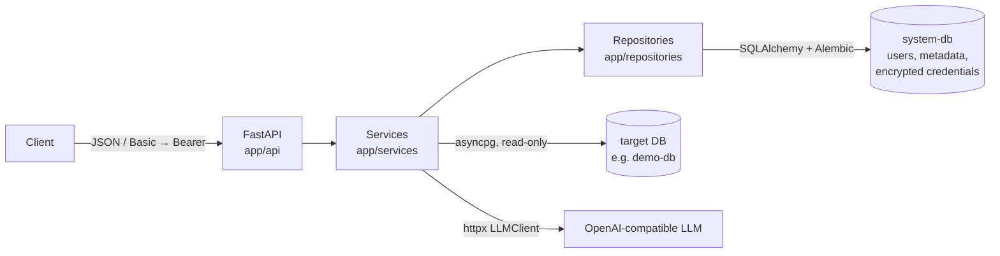

# LLM Data Discovery

A FastAPI service that connects to PostgreSQL databases, extracts and stores their schema metadata, and classifies columns into 12 PII categories. It samples column values, masks them, and asks an OpenAI-compatible LLM for a probability distribution.

## Architecture

A modular monolith with layered responsibilities. Routes contain no SQL, prompts or business logic.



```
app/
  api/
    routes/            auth.py, metadata.py, classification.py: HTTP only
    dependencies.py    auth guard, shared clients
  core/                config.py, security.py (JWT, Argon2, AES-GCM), exceptions.py
  domain/              models.py (ORM entities), enums.py, schemas.py (request/response)
  services/            auth, metadata, classification, sample_sanitizer, classification_parser
  repositories/        user, connection, metadata: all system DB queries
  infrastructure/
    database/          system_database.py, target_database.py (connect, inspect schema, sample)
    llm/               llm_client.py (OpenAI-compatible HTTP client), prompts.py
alembic/               system DB migrations
db/demo/               demo target database init script
tests/                 unit/, integration/, e2e/
```

**Two separate databases:**

- The **system DB** is the application's own store.
- A **target DB** is any external database being analyzed. Compose ships one target, `demo-db`, seeded with the case study script.

**System DB relationships:** `db_connections` 1─N `db_metadata` (snapshots) 1─N `db_tables` 1─N `db_columns`. There is also a `users` table.

## Technology Stack

| Component | Technology |
|---|---|
| Language / framework | Python 3.12, FastAPI, Pydantic v2, pydantic-settings |
| System DB access | SQLAlchemy 2 (async) + asyncpg, Alembic migrations |
| Target DB access | asyncpg (read-only sessions, statement timeout) |
| LLM | Any OpenAI-compatible `/chat/completions` API via an `httpx`-based `LLMClient` |
| Security | Argon2id password hashing, JWT (HS256), AES-256-GCM credential encryption |
| Tests | pytest, pytest-asyncio, httpx `MockTransport` / `ASGITransport` |
| Runtime | Docker, Docker Compose, PostgreSQL 16 |

## Prerequisites

- Docker with Docker Compose v2
- `openssl` (to generate secrets)
- An API key for an OpenAI-compatible LLM, or a local one (see [LLM provider configuration](#llm-provider-configuration))

## Environment Configuration

All configuration is read from environment variables, normally via `.env`. `.env` is git-ignored. [.env.example](.env.example) lists every variable with safe placeholders and comments.

```bash
cp .env.example .env
sed -i.bak "s|^JWT_SECRET_KEY=.*|JWT_SECRET_KEY=$(openssl rand -hex 32)|" .env
sed -i.bak "s|^ENCRYPTION_KEY=.*|ENCRYPTION_KEY=$(openssl rand -base64 32)|" .env
rm .env.bak
$EDITOR .env   # set LLM_API_KEY, and change every change-me-* value
```

| Group | Variables |
|---|---|
| Application | `APP_ENV`, `APP_PORT`, `LOG_LEVEL`, `CORS_ALLOWED_ORIGINS`, `MAX_REQUEST_BODY_BYTES` |
| System DB | `SYSTEM_DB_HOST`, `SYSTEM_DB_PORT`, `SYSTEM_DB_NAME`, `SYSTEM_DB_USER`, `SYSTEM_DB_PASSWORD` |
| Authentication | `AUTH_USERNAME`, `AUTH_PASSWORD`, `JWT_SECRET_KEY`, `JWT_ALGORITHM`, `JWT_EXPIRE_MINUTES` |
| Encryption | `ENCRYPTION_KEY` (base64, 32 bytes) |
| LLM | `LLM_BASE_URL`, `LLM_API_KEY`, `LLM_MODEL`, `LLM_TIMEOUT`, `LLM_MAX_RETRIES`, `LLM_JSON_MODE` |
| Target DB / sampling | `TARGET_DB_CONNECT_TIMEOUT_SECONDS`, `TARGET_DB_STATEMENT_TIMEOUT_MS`, `MAX_SAMPLE_COUNT`, `SAMPLE_MASKING_MODE`, `CHECKSUM_VALIDATION_ENABLED`, `CLASSIFICATION_CACHE_TTL_SECONDS` |
| Demo DB | `DEMO_DB_NAME`, `DEMO_DB_USER`, `DEMO_DB_PASSWORD` (owner), `DEMO_DB_READONLY_USER`, `DEMO_DB_READONLY_PASSWORD` (SELECT-only login for scanning), `DEMO_DB_EXPOSED_PORT` |

## Docker Compose Startup

```bash
docker compose up --build -d
curl http://localhost:8000/health   # {"status":"ok"}
open http://localhost:8000/         # web UI
```

| Service | Purpose |
|---|---|
| `app` | FastAPI on port `8000` |
| `system-db` | PostgreSQL 16, the application's own database |
| `demo-db` | PostgreSQL 16 seeded from [db/demo/](db/demo/) on first start; exposed on host port `5433` |
| `ollama` | *(profile `local-llm`, optional)* Local OpenAI-compatible LLM; see [LLM provider configuration](#llm-provider-configuration) |

## Database Initialization and Migrations

- On every start, the `app` container runs `alembic upgrade head` and then launches uvicorn.
- At startup the app creates the admin user from `AUTH_USERNAME` / `AUTH_PASSWORD`, stored as an Argon2 hash. If `AUTH_PASSWORD` changes, the hash is updated on the next start.
- `demo-db` runs the init scripts in [db/demo/](db/demo/) only when its volume is empty: the case study demo script, then `02_readonly_user.sh` (the SELECT-only login). To re-seed, run `docker compose down -v`; this also wipes the system DB. To add only the read-only login to an existing volume: `docker compose exec demo-db sh /docker-entrypoint-initdb.d/02_readonly_user.sh`.

| Migration | Content |
|---|---|
| `0001` | Metadata, tables, columns, connections |
| `0002` | `users` table; connections become reusable (1─N snapshots); `schema_name` and `table_count` on metadata. Existing data is migrated: duplicate connections are merged, keeping the newest password. Irreversible |

## Web UI

Open http://localhost:8000/ (redirects to `/ui/`) and sign in with `AUTH_USERNAME` / `AUTH_PASSWORD`. The UI is a static page served by the app itself (no build step, no external scripts), calling the same `/api/v1` endpoints:

- **Scan a database:** connection form (prefilled for `demo-db`) → `POST /db/metadata`
- **Snapshots:** list → `GET /metadata`; select one → `GET /metadata/{id}`; delete → `DELETE /metadata/{id}`
- **Tables and columns:** filter, then **Classify** one column or **Classify all** in a table → `POST /classify`. Click a classified row to see the 12-category distribution, `pii_likelihood`, checksum evidence (final vs. LLM-only bars) and the LLM's reasoning.

The token is kept in `sessionStorage` (cleared when the tab closes). The `/ui` responses carry a strict `Content-Security-Policy` (`'self'` only, no inline scripts or styles, `frame-ancestors 'none'`); all server data is rendered with `textContent`.

## API Documentation

Swagger UI is at http://localhost:8000/docs and the OpenAPI schema at `/openapi.json`. Both are disabled when `APP_ENV=production`.

## Authentication

`POST /api/v1/auth` returns a JWT. It accepts credentials in either form:

- a JSON body: `{"username": "...", "password": "..."}`
- HTTP Basic authentication

Every other endpoint under `/api/v1` requires `Authorization: Bearer <token>`. HTTP Basic credentials are also accepted directly.

```bash
TOKEN=$(curl -s -X POST http://localhost:8000/api/v1/auth \
  -H "Content-Type: application/json" \
  -d '{"username":"admin","password":"change-me-admin"}' | jq -r .access_token)
```

## API Endpoints

| Method | Path | Description |
|---|---|---|
| `POST` | `/api/v1/auth` | Exchange credentials for a JWT |
| `POST` | `/api/v1/db/metadata` | Connect to a database, extract and store its metadata |
| `GET` | `/api/v1/metadata` | List metadata snapshots (`limit`, `offset`) |
| `GET` | `/api/v1/metadata/{metadata_id}` | Tables, columns, column IDs and data types |
| `DELETE` | `/api/v1/metadata/{metadata_id}` | Delete a snapshot with its tables and columns; the connection is kept |
| `POST` | `/api/v1/classify` | Classify a column into the 12 PII categories |
| `GET` | `/health` | Liveness check |

**Unversioned aliases.** The case study lists the endpoints without a prefix (`/auth`, `/db/metadata`, `/metadata`, `/metadata/{id}`, `/classify`). Those paths are served too, by the same handlers. They are hidden from Swagger; `/api/v1` is the documented API.

A ready-made walkthrough is in [requests.http](requests.http). The same flow with curl:

```bash
API=http://localhost:8000/api/v1
AUTH="Authorization: Bearer $TOKEN"

# Extract metadata. The app runs inside compose, so the host is "demo-db", not "localhost".
# Optional: "schema_name": "public" to extract a single schema.
METADATA_ID=$(curl -s -X POST $API/db/metadata -H "$AUTH" -H "Content-Type: application/json" \
  -d '{"host":"demo-db","port":5432,"database":"llm_discovery_demo","username":"discovery_reader","password":"change-me-demo-reader"}' \
  | jq -r .metadata_id)

curl -s $API/metadata -H "$AUTH" | jq
curl -s $API/metadata/$METADATA_ID -H "$AUTH" | jq

# Classify customers.email
COLUMN_ID=$(curl -s $API/metadata/$METADATA_ID -H "$AUTH" \
  | jq -r '.tables[] | select(.table_name=="customers") | .columns[] | select(.column_name=="email") | .column_id')
curl -s -X POST $API/classify -H "$AUTH" -H "Content-Type: application/json" \
  -d "{\"column_id\":\"$COLUMN_ID\",\"sample_count\":10}" | jq

curl -s -X DELETE $API/metadata/$METADATA_ID -H "$AUTH"
```

### `POST /api/v1/classify` response

```json
{
  "column_id": "8f0c…",
  "metadata_id": "1a2b…",
  "schema_name": "public",
  "table_name": "customers",
  "column_name": "email",
  "data_type": "character varying(100)",
  "sample_count_requested": 10,
  "sample_count_used": 5,
  "masking_mode": "partial",
  "classification": {
    "email_address": 0.95, "phone_number": 0.0, "ssn": 0.0, "credit_card_number": 0.0,
    "national_id_number": 0.0, "full_name": 0.05, "first_name": 0.0, "last_name": 0.0,
    "tckn": 0.0, "home_address": 0.0, "date_of_birth": 0.0, "ip_address": 0.0
  },
  "predicted_category": "email_address",
  "pii_likelihood": 0.97,
  "llm_classification": { "email_address": 0.95, "full_name": 0.05, "…": 0.0 },
  "llm_pii_likelihood": 0.97,
  "checksum_evidence": [
    { "category": "email_address", "check": "email_format", "matched": 5, "checked": 5, "weight": 0.6 }
  ],
  "reasoning": "All samples are email addresses.",
  "model": "gpt-4o-mini",
  "classified_at": "2026-11-05T15:13:05Z",
  "cached": false
}
```

- `classification` always contains all 12 categories. It is validated and normalized to sum to 1 (tolerance `1e-3`). It answers "which category does this column most resemble?"
- `pii_likelihood` answers "is this column PII at all?" Without it, a column such as `unit_price` would have to be reported as some PII class. See [Design decisions](#design-decisions--assumptions).
- `classification` / `pii_likelihood` are the final values: the LLM's answer fused with the checksum evidence. `llm_classification` / `llm_pii_likelihood` are the LLM's answer before fusion; `checksum_evidence` lists the checks that applied (see [Checksum validation](#checksum-validation-tckn-luhn-email-ip)).
- `cached` is `true` when the result was reused; `classified_at` is when the LLM produced it. Send `"force_refresh": true` in the request to skip the cache.
- Sample values are never returned.

### Error responses

| Status | When |
|---|---|
| `400` | `POST /db/metadata` cannot connect with the supplied details (generic message) |
| `401` | Missing or invalid credentials/token |
| `404` | Unknown metadata or column ID |
| `409` | The column/table no longer exists in the target DB (metadata is stale) |
| `413` | Request body larger than `MAX_REQUEST_BODY_BYTES` |
| `422` | Validation error, e.g. `sample_count` out of range or an unknown `schema_name` |
| `502` | Stored target DB unreachable, or the LLM failed / returned unusable output |

## How Classification Works

1. The column, its table, the snapshot and the stored connection are looked up from `column_id`.
2. The password is decrypted and a **read-only** connection with a statement timeout is opened.
3. Up to `sample_count` **distinct, non-null** values are fetched, cast to text and truncated to 200 characters, ordered by `md5(value)`: a pseudo-random spread that stays the same while the data is unchanged (needed for the cache, and reproducible). `inet` values are taken via `host()`, so there is no netmask. Identifiers are validated and quoted; the limit is a bind parameter.
4. **Cache lookup** (see [Classification cache](#classification-cache)). On a hit the stored result is returned with `cached: true` and steps 5–8 are skipped.
5. Samples are masked according to `SAMPLE_MASKING_MODE` (see below).
6. The LLM gets the category definitions, the column metadata and the JSON-encoded samples between explicit delimiters. It must reply with JSON: `{"pii_likelihood", "classification", "reasoning"}`. Requests use `temperature=0` and JSON mode.
7. The reply is validated:
   - Every value must be a probability in `[0, 1]`.
   - Unknown categories are dropped and missing ones set to 0.
   - The distribution is rescaled to sum to 1.
   - An invalid reply is re-requested up to twice. Timeouts, 429 and 5xx responses are retried with exponential backoff.
8. Deterministic checks run on the **raw** samples and are fused into the result (see below). The result is stored in the cache.

The scores are model confidence, **not calibrated statistical probabilities**; the deterministic checks and the cache make them more stable, not calibrated.

### Checksum validation (TCKN, Luhn, email, IP)

The LLM only sees masked samples and is not deterministic: on repeated runs `gpt-4o-mini` scored the demo `customers.national_id` column as `tckn`/`national_id_number` 0.5/0.5, 0.1/0.9 or 0/1. Deterministic checks on the unmasked values (inside the app; only match counts are kept) back the LLM up for the categories that have a syntactic definition. Names, addresses, phone numbers and dates of birth depend on context (a date is not necessarily a birth date), so they are left to the LLM.

| Check | Passes when | Weight |
|---|---|---|
| `tckn_checksum` | 11 digits, no leading 0, digit 10 = `(7·(d1+d3+d5+d7+d9) − (d2+d4+d6+d8)) mod 10`, digit 11 = `(d1+…+d10) mod 10` | 0.6 |
| `tckn_format` | 11 digits, no leading 0 (used when the checksum fails; the case study's own TCKN examples such as `12345678901` fail it) | 0.3 |
| `luhn` | 13–19 digits (spaces/hyphens allowed) passing the Luhn check | 0.6 |
| `email_format` | The whole value is an email address (`local@domain.tld`) | 0.6 |
| `ip_address` | The whole value parses as an IPv4 or IPv6 address | 0.6 |

A check counts as evidence when at least 80% of the non-empty samples pass it. Fusion, per evidence item:

1. For TCKN, the probability on the generic `national_id_number` moves to the specific `tckn` (an 11-digit Turkish-shaped "national ID" is a TCKN).
2. `final = (1 − weight) · llm + weight · one_hot(category)`; `pii_likelihood` is pulled toward 1 the same way.

An LLM answer for an unrelated category survives: the 11-digit `employees.social_security_number` column stays `ssn` 0.7 / `tckn` 0.3. Disable with `CHECKSUM_VALIDATION_ENABLED=false`.

### Classification cache

Calling the LLM again for an unchanged column costs money and 2–3 s, and can give a different answer. A result is stored in `classification_results` and reused when **all** of these are unchanged:

| Part of the cache key | Why |
|---|---|
| `column_id`, `sample_count` | Same column (snapshot), same request |
| Fingerprint of the sample values | Data unchanged. HMAC-SHA256 keyed with `ENCRYPTION_KEY`, so it cannot be brute-forced back to short values such as TCKNs; raw values are never stored |
| `LLM_BASE_URL`, `LLM_MODEL`, system prompt hash, logic version | Same model and prompt |
| `SAMPLE_MASKING_MODE`, `CHECKSUM_VALIDATION_ENABLED` | Same settings |

- The target database is still queried on every request: the fresh samples are how the cache knows the data is unchanged. A cache hit takes ~30 ms instead of ~3 s.
- `"force_refresh": true` skips the lookup and replaces the stored result (the UI's **Re-run** button does this).
- Results expire after `CLASSIFICATION_CACHE_TTL_SECONDS` (default 86400); `0` disables the cache.
- Deleting a snapshot deletes its cached results (`ON DELETE CASCADE`).

### Sample masking

| `SAMPLE_MASKING_MODE` | Effect | Example |
|---|---|---|
| `none` | Values are sent as is | `ahmet.yilmaz@email.com` |
| `partial` (default) | The email local part and the middle digits of values with ≥ 6 digits are replaced with `*`. Length, separators and domains are kept; names and addresses are not changed | `a***********@email.com`, `12*******01`, `+90 *** *** **67` |
| `strict` | Letters → `x`/`X`, digits → `9`; only the shape remains | `xxxxx.xxxxxx@xxxxx.xxx` |

Masking trades accuracy for privacy. `partial` keeps formats recognizable but leaves names readable. Names cannot be classified once they are unreadable. For real personal data, prefer a self-hosted model.

## Running Tests

Tests are split into four levels:

| Level | Scope | Needs |
|---|---|---|
| `tests/unit` | Security, masking, parser, checksum checks + fusion, cache key, prompts, LLM client (mocked HTTP), SQL building, HTTP guards/validation, UI serving | Nothing |
| `tests/integration` | Auth service, metadata extraction/persistence/deletion, classification flow against real PostgreSQL | Test DBs |
| `tests/e2e` | Full API flow: auth → extract → list → detail → classify → delete | Test DBs |
| `tests/contract` | Black-box API contract over HTTP only (no imports from `app`): auth, extraction, list/detail, validation, checksum rules, cache, delete. Meant to be run unchanged against the Java port | A running deployment + real LLM |

In unit, integration and e2e tests the LLM is mocked, so they never call a live provider. These three levels run with one command, using dedicated throwaway databases (tmpfs) seeded with the demo script:

```bash
docker compose --profile test run --build --rm tests
docker compose rm -sf test-system-db test-target-db   # clean up the test databases
```

Unit tests only, without Docker:

```bash
python -m venv .venv && source .venv/bin/activate
pip install -r requirements-dev.txt
pytest tests/unit
```

Integration and e2e tests are skipped unless `RUN_INTEGRATION=1` is set. They also need `SYSTEM_DB_*` and `TEST_TARGET_DB_*` variables pointing at disposable databases, as set in the compose `tests` service.

### Contract tests (same tests for Python and Java)

The contract suite runs against a live deployment and the demo database, with the real LLM. It only asserts rules that hold for any LLM answer (structure, status codes, checksum effects, cache, delete semantics), so it can verify any implementation of the API:

```bash
docker compose up -d
docker compose --profile contract run --build --rm contract-tests                                  # Python service
docker compose --profile contract run --build --rm -e CONTRACT_BASE_URL=http://<java-service>:<port> contract-tests   # Java port
```

Without `CONTRACT_BASE_URL` the suite is skipped, so the default test run is unaffected. It creates its own snapshots and deletes them; it makes about 10 LLM calls.

## LLM Provider Configuration

Any server implementing the OpenAI `/chat/completions` API works:

| Provider | `LLM_BASE_URL` | `LLM_MODEL` example |
|---|---|---|
| OpenAI | `https://api.openai.com/v1` | `gpt-4o-mini` |
| Ollama via compose (`local-llm` profile) | `http://ollama:11434/v1` | `llama3.1` |
| Ollama installed on the Docker host | `http://host.docker.internal:11434/v1` | `llama3.1` |
| vLLM / LM Studio / Azure OpenAI (compatible endpoint) | the server's `/v1` URL | the deployed model name |

`LLM_API_KEY` can be left empty for providers that need no key; no `Authorization` header is sent then.

### Fully local LLM with Ollama (no data leaves the machine)

```bash
docker compose --profile local-llm up -d
docker compose exec ollama ollama pull llama3.1      # ~4.9 GB, once
# .env: LLM_BASE_URL=http://ollama:11434/v1, LLM_API_KEY=, LLM_MODEL=llama3.1, LLM_TIMEOUT=300
docker compose up -d app                             # reload .env
```

The model needs about 6 GB of memory available to Docker. Without a GPU, inference runs on the CPU and a classification takes from tens of seconds to a few minutes, so raise `LLM_TIMEOUT`.

### Evaluating classification quality

[scripts/evaluate_classification.py](scripts/evaluate_classification.py) extracts the demo DB, classifies 29 representative columns through the API and compares each result with the expected category:

```bash
docker compose exec -T app python - < scripts/evaluate_classification.py
```

The script only uses the HTTP API, so the same run can be repeated against another implementation of the API (e.g. the Java port) for comparison. Results are recorded in `TASK.md`.

If the server rejects `response_format`, set `LLM_JSON_MODE=false`. The parser tolerates JSON wrapped in prose or code fences. `LLM_TIMEOUT` (seconds) and `LLM_MAX_RETRIES` control resilience.

## Security Considerations

| Control | Implementation |
|---|---|
| Authentication | All `/api/v1` endpoints except `/auth` require a JWT or Basic credentials |
| Password hashing | Argon2id. Unknown usernames are checked against a dummy hash, so timing doesn't reveal which accounts exist |
| Credentials at rest | Target DB passwords are encrypted with AES-256-GCM (random nonce). The key comes only from `ENCRYPTION_KEY` and is never stored in the DB. Passwords are never returned |
| Secrets | Only via environment / `.env` (git-ignored) |
| Read-only target access | Two layers. (1) Every target session uses `default_transaction_read_only=on` and a `statement_timeout`, even with an owner login. (2) `demo-db` has a SELECT-only login (`DEMO_DB_READONLY_USER`, created by [db/demo/02_readonly_user.sh](db/demo/02_readonly_user.sh)): no INSERT/UPDATE/DELETE/CREATE privileges even if the session setting is turned off. Integration tests check both. For real databases, create an equivalent role and scan with it |
| SQL injection | Only the sample limit is a value, and it is bound. Identifiers come from the stored catalog and are validated (non-empty, no NUL, ≤ 63 bytes) and quoted. LLM output is never executed |
| LLM input | Samples are masked, truncated, JSON-encoded and delimited. The prompt marks them as untrusted data |
| LLM output | Strictly validated, so a manipulated reply can at most skew a distribution |
| Limits | `sample_count` ≤ `MAX_SAMPLE_COUNT`; request bodies ≤ `MAX_REQUEST_BODY_BYTES`; connect/statement/LLM timeouts |
| Logging | No credentials or sample values are logged. Target DB failures are logged with host/db and SQLSTATE only, and API errors are generic |
| CORS | Disabled unless `CORS_ALLOWED_ORIGINS` lists origins |

Notes:

- **PII sent to the LLM.** Even when masked, samples leave the system. Use a self-hosted model or a provider with suitable data-processing terms (KVKK/GDPR), e.g. a zero-retention configuration.
- **SSRF.** `POST /db/metadata` makes the server connect to a caller-supplied host/port. It requires authentication. Production deployments should also restrict egress or allow-list targets.
- Generate fresh `JWT_SECRET_KEY` / `ENCRYPTION_KEY` values and change every `change-me-*` value. Changing `ENCRYPTION_KEY` makes stored connections unreadable.

## Design Decisions & Assumptions

The case study leaves several choices to the developer. They are answered here.

| Question | Decision | Why |
|---|---|---|
| Re-extracting metadata: update the old record or create a new snapshot? | **New snapshot** every time. The connection row is reused (same host/port/database/username) and its encrypted password refreshed | Snapshots are immutable history: classification results and column IDs of an older snapshot stay valid. Deleting a snapshot never deletes the connection |
| Is the column UUID regenerated on every extraction? | **Yes**, every snapshot gets new column IDs | A column ID identifies a column *in a snapshot*; reusing IDs would mix results across schema versions. Cached results are tied to the column ID and deleted with the snapshot |
| How are non-PII columns represented? | The 12-category `classification` always sums to 1 (as the spec requires) and answers "which category does it most resemble". A separate `pii_likelihood` answers "is it PII at all". When nothing fits: uniform distribution, `predicted_category: null`, `pii_likelihood: 0`; the UI shows "Not PII" below 0.5 | Without the extra field, a column like `unit_price` would have to be reported as some PII class |
| Can a column contain more than one PII category? | The **distribution** expresses mixtures (e.g. a notes column with emails and phone numbers spreads its mass); `predicted_category` is the single most likely one. Deterministic checks only fire when ≥ 80% of the samples match one category, so they never force a single label on mixed columns | The spec asks for one probability distribution per column; multi-label output would change the contract |
| How are samples anonymized before they reach the LLM provider? | `SAMPLE_MASKING_MODE`: `partial` (default) masks email local parts and middle digits of numbers with ≥ 6 digits, keeping the format; `strict` keeps only the shape; `none` sends values as is. Deterministic checks run on the raw values inside the app; only counts leave it | Classification needs the format, not the identity. For real personal data a self-hosted model (Ollama profile) avoids sending anything out |
| Are the scores probabilities? | They are **model confidence scores, not calibrated probabilities**, stabilized by deterministic checks and the cache | No labeled data to calibrate against; the API docs and UI say so |
| How is repeated classification of the same column handled? | Cached on column, samples, model, prompt and settings; reused for `CLASSIFICATION_CACHE_TTL_SECONDS` (see [Classification cache](#classification-cache)) | Cost, latency, and a stable answer for unchanged data |
| What happens to snapshots when a connection is deleted? | Connections are never deleted through the API; there is no endpoint for it. The FK `db_metadata.connection_id` is `ON DELETE RESTRICT`, so a connection can only be removed (manually) once no snapshot references it | A connection is shared by all snapshots of the same target; silently cascading would delete history |
| Does deleting a snapshot delete its tables and columns? | **Yes**: `db_tables`, `db_columns` and the cached `classification_results` go with it (`ON DELETE CASCADE`); the connection stays | Nothing else refers to them, so orphans would only waste space |
| Are classification results stored? | **Yes**, in `classification_results`, as the cache (TTL `CLASSIFICATION_CACHE_TTL_SECONDS`); the latest result per key is kept, not a history | Avoids repeated LLM calls; a history table can be added if auditing needs it |
| Which DB user scans the target? | A SELECT-only login; the demo ships `discovery_reader` | Least privilege; the app's read-only session is the second layer |
| How are the Python and Java implementations kept equivalent? | One black-box contract suite (`tests/contract`) and the evaluation script, both HTTP only, run against both | Same request → same contract and business rules |

Other decisions:

- **Auth accepts a JSON body and HTTP Basic.** The spec defines a JSON body; the case study asks for Basic authentication. Both are supported.
- **Metadata scope.** Tables, partitioned tables, views, materialized views and foreign tables in all non-system schemas, or one schema via `schema_name`. Partitions are folded into their parent. Types come from `format_type()`, e.g. `character varying(50)`, `numeric(10,2)`.
- **Masked card numbers** (`****-****-****-1234`) are described to the LLM as credit card data. The goal is finding columns that hold card data.
- **Credential format.** AES-GCM is stored as `base64(nonce || ciphertext || tag)`, the same layout as Java's `AES/GCM/NoPadding`, so the Java port can share the system DB.
- **Deviations from the technical spec's stack table:**
  - `asyncpg` instead of `psycopg`; it is functionally equivalent here.
  - `APP_SECRET_KEY` is omitted because the spec defines no use for it.

## Known Limitations

- Sampling (`DISTINCT … ORDER BY md5(value)`) scans the whole column. For very large tables, `TABLESAMPLE` would be cheaper. The deterministic order also means a large column is always judged on the same subset of its values (until the data changes).
- One column per classification request. A batch endpoint, or a whole-table prompt where columns give each other context, would cut cost and improve accuracy.
- The `tckn_format` check (no checksum) also matches other 11-digit national IDs (e.g. Polish PESEL); those columns get pulled toward `tckn`. Masked card numbers (`****-****-****-1234`) cannot be Luhn-checked. Fusion weights are hand-set, not calibrated.
- `pii_likelihood` and the distribution are LLM estimates and are not calibrated.
- A cache hit still opens a connection to the target database (to fingerprint the samples).
- There is one bootstrap admin user and no user-management endpoints.
- The body size limit relies on `Content-Length`. Chunked uploads are not counted; a reverse proxy should enforce a hard limit.
- Migration `0002` is irreversible.
